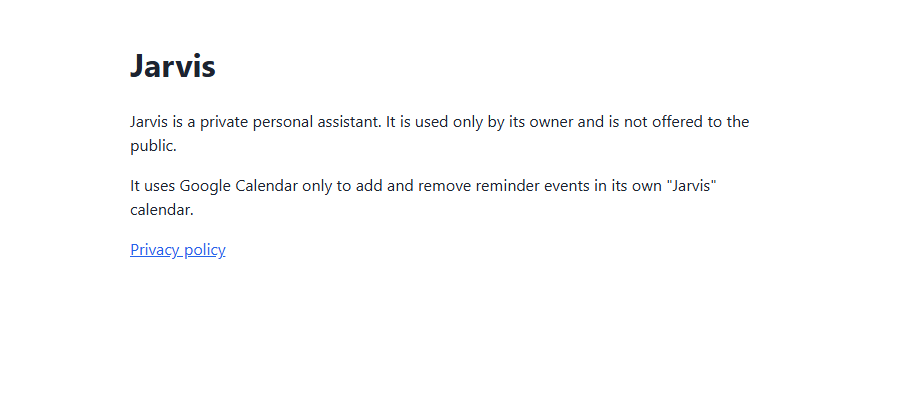
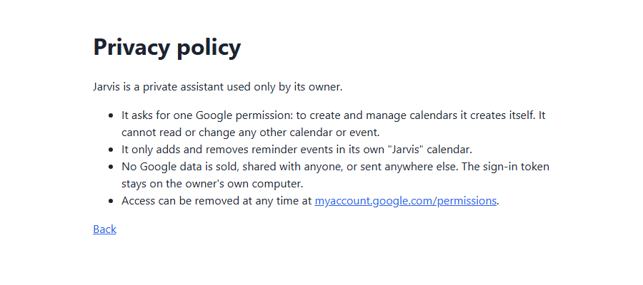
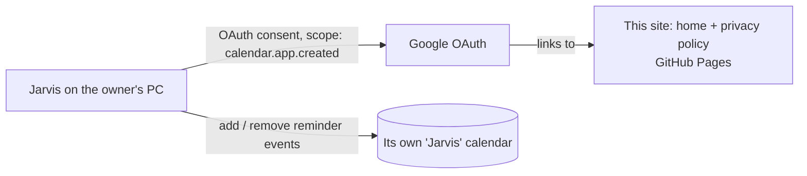

# Jarvis: public pages for the Google sign-in

**The public home page and privacy policy that Google OAuth requires for Jarvis, a private assistant for running construction sites.**

Live at **https://acem28.github.io/jarvis-app/** (GitHub Pages). The assistant itself is in a separate private repository: `acem28/jarvis`.

## Why this repo exists

Jarvis adds backup phone alarms to its own Google Calendar. An OAuth app that stays in "Testing" mode loses its
sign-in every 7 days. To publish it "In production", Google requires a public home page and a privacy policy on a
domain the developer controls. This repository is that page and nothing more: static HTML, no scripts, no tracking,
no personal data.

## Screenshots

| Home | Privacy policy |
|---|---|
|  |  |

## Architecture



## Tech stack

Static HTML + inline CSS · GitHub Pages.

## Run locally

```bash
python -m http.server 8000   # then open http://localhost:8000
```

No build step, no environment variables.

## License

Copyright (c) 2026 Fabion Minaj. All rights reserved. See [LICENSE](LICENSE).
